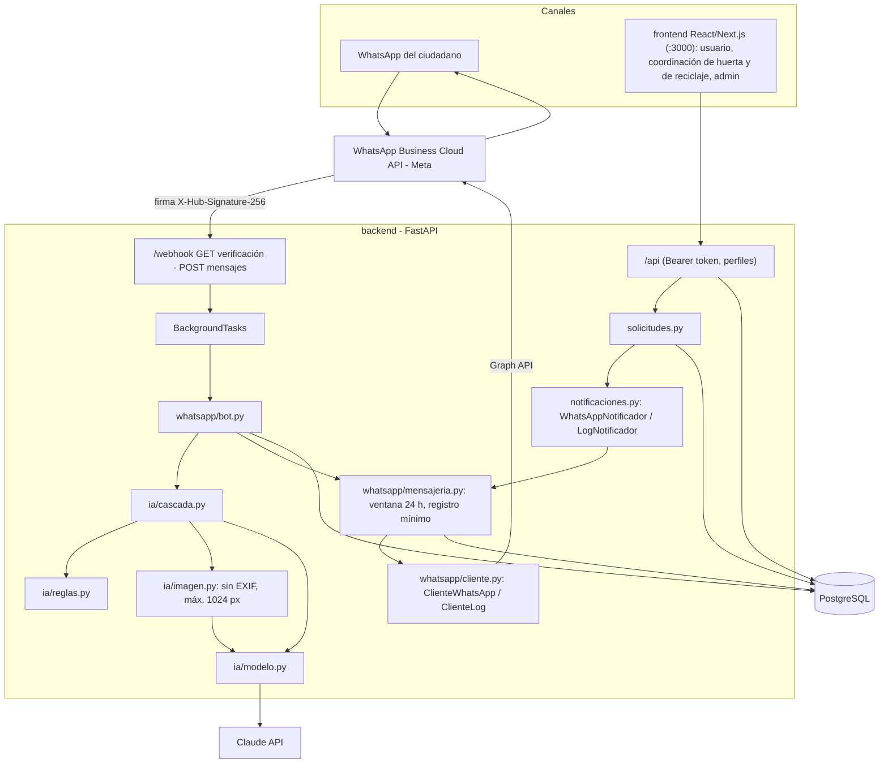
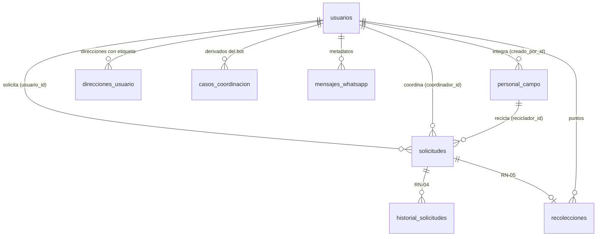
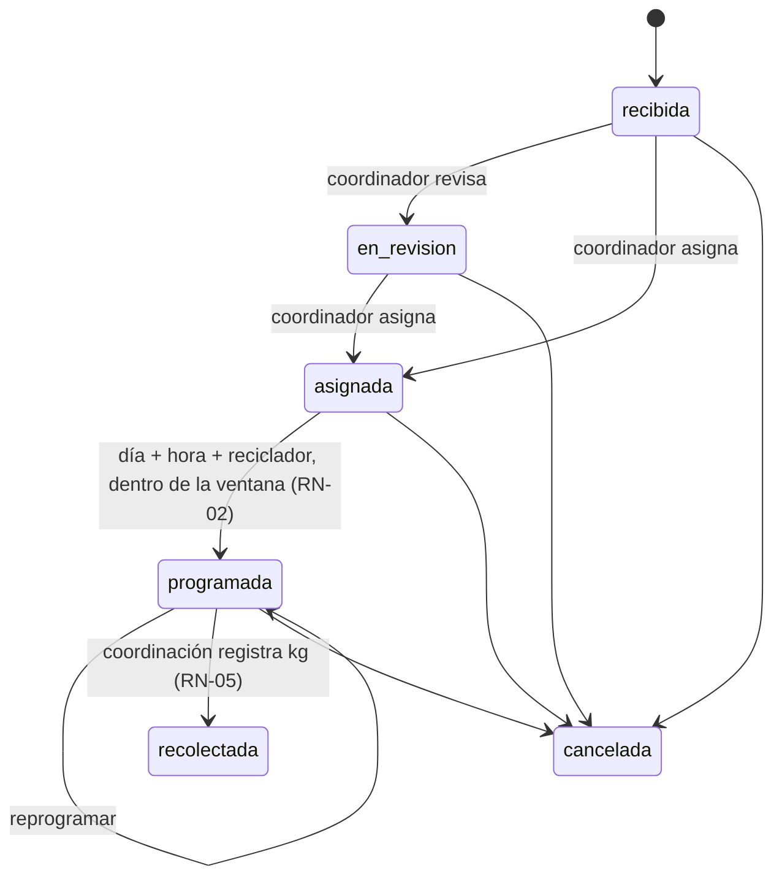

# Arquitectura de EcoConecta

## Flujo de un mensaje

1. Meta envía `POST /webhook`. Si la firma no coincide con `WHATSAPP_APP_SECRET`, se responde 403.
2. Por cada mensaje se inserta su `wa_message_id` en `mensajes_whatsapp`, que es `UNIQUE`. Si ya existía, es un reintento y se descarta.
3. Se responde 200 de inmediato, y `bot.procesar` corre en segundo plano.
4. El bot normaliza `wa_id` a E.164, busca al usuario y aplica el límite diario. Luego detecta la intención: menú, opciones 1 a 6, código ORG/REC, foto, duda de residuo, contenidos o derivación.
5. La respuesta sale por `mensajeria.enviar`, que decide entre texto y plantilla según la ventana de 24 h y deja el registro.

## Modelo de datos (PostgreSQL)

| Tabla | Uso |
|---|---|
| `usuarios` | Solo los 4 perfiles con acceso (`rol`), `telefono` E.164 único, `direccion`, `zona`, `tipo_generador`, `piloto` (RN-08), `clave_hash` (scrypt) |
| `personal_campo` | Recicladores (con `zona`) y voluntarios de huerta, sin cuenta: `nombre`, `apellido`, `dias_servicio`, `hora_desde`, `hora_hasta`, `activo` |
| `direcciones_usuario` | Direcciones extra del usuario con `etiqueta` ("Casa mamá") y `zona` |
| `solicitudes` | `codigo` ORG-/REC-, `flujo` (RN-01), `tipo_generador`, `estado`, `direccion`, `disponibilidad`, `observaciones`, `zona`, `tamano`, `dias_disponibles`, `hora_desde`/`hora_hasta`, `bonificacion`, `coordinador_id` y `reciclador_id` (RN-03), `fecha_programada` y `hora_programada` (RN-02) |
| `historial_solicitudes` | Cada cambio de estado, con quién lo hizo y una nota (RN-04) |
| `recolecciones` | Kg entregados, puntos y la fórmula aplicada (RN-05, RN-06), quién la registró (columna `recolector_id`, hoy el coordinador) y `reciclador_id`. Una por solicitud |
| `contenidos` | Material educativo. Es la única fuente de información del bot |
| `mensajes_whatsapp` | `wa_message_id` (UNIQUE), `wa_id`, `direccion`, `tipo`, `intencion`, `estado_envio`, `retener_hasta` |
| `conversaciones_whatsapp` | Ventana de 24 h, fallos seguidos, paso actual y último flujo |
| `casos_coordinacion` | Casos derivados por el bot a la bandeja del coordinador |

## Estados de una solicitud

## Cascada de IA

1. **Reglas** (`ia/reglas.py`): palabras clave, sin costo. Si aparecen palabras de los dos flujos, la sugerencia es mezcla.
2. **Modelo con texto** (`ia/modelo.py`, `IA_MODELO_TEXTO`): solo si las reglas no deciden.
3. **Modelo con visión** (`IA_MODELO_VISION`): para fotos, ya limpias.

Si la IA no responde a tiempo o falta la clave, el usuario recibe un mensaje de contingencia con el enlace al formulario.
