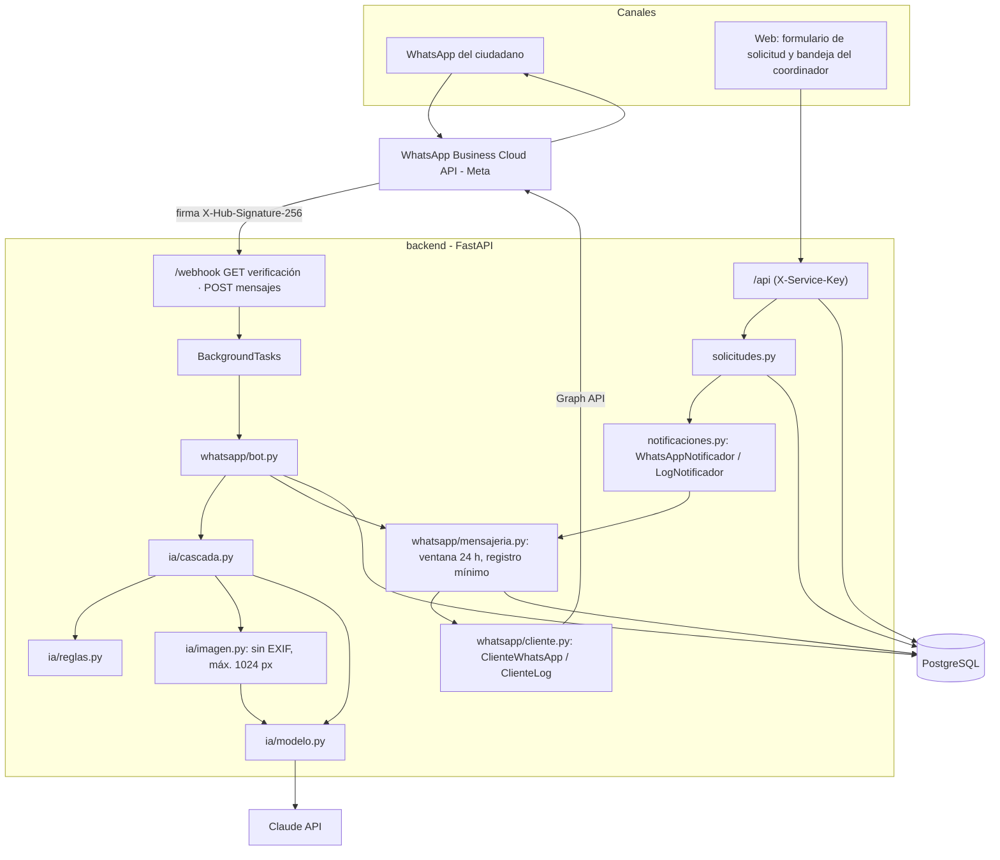

# Arquitectura de EcoConecta

## Flujo de un mensaje

1. Meta envía `POST /webhook`. Si la firma no coincide con `WHATSAPP_APP_SECRET`, se responde 403.
2. Por cada mensaje se inserta su `wa_message_id` en `mensajes_whatsapp`, que es `UNIQUE`. Si ya existía, es un reintento y se descarta.
3. Se responde 200 de inmediato, y `bot.procesar` corre en segundo plano.
4. El bot normaliza `wa_id` a E.164, busca al usuario y aplica el límite diario. Luego detecta la intención: menú, opciones 1 a 6, código ORG/REC, foto, duda de residuo, contenidos o derivación.
5. La respuesta sale por `mensajeria.enviar`, que decide entre texto y plantilla según la ventana de 24 h y deja el registro.

## Tablas

| Tabla | Uso |
|---|---|
| `usuarios` | Ciudadanos, coordinadores (con `flujo`) y recolectores. `telefono` en E.164, único |
| `solicitudes` | `codigo` ORG-/REC-, `flujo`, `estado`, fecha y hora programadas, `encargado_id` |
| `contenidos` | Tutorial, horarios y rutas. Es la única fuente de la información educativa del bot |
| `mensajes_whatsapp` | `wa_message_id` (UNIQUE), `wa_id`, `direccion`, `tipo`, `intencion`, `estado_envio`, `retener_hasta` |
| `conversaciones_whatsapp` | Último mensaje entrante (ventana de 24 h), fallos seguidos, paso actual y último flujo |
| `casos_coordinacion` | Bandeja del coordinador: casos derivados por el bot |

## Cascada de IA

1. **Reglas** (`ia/reglas.py`): palabras clave, sin costo. Si aparecen palabras de los dos flujos, la sugerencia es mezcla.
2. **Modelo con texto** (`ia/modelo.py`, `IA_MODELO_TEXTO`): solo si las reglas no deciden.
3. **Modelo con visión** (`IA_MODELO_VISION`): para fotos, ya limpias.

Si la IA no responde a tiempo o falta la clave, el usuario recibe un mensaje de contingencia con el enlace al formulario.
